## Farmer_Markus
I love open source software and my goal is to rewrite Nintendo's Legend of Zelda Spirit Tracks in c++ and use the original 3d models/textures and music.

### Goals
- Create Linux mime editor / TUI interface
- Enhance [Settlers 2 android port](https://github.com/Farmer-Markus/s25rttr-android)
- Create 2D [Factorio](https://www.factorio.com/) inspired game
- Create libnitro (Nintendo Nitro fs lib)
- Recreate Nintedo's Zelda Spirit Tracks using libnitro

### AI
I like AI being used to help develop software, but not AI developing software alone.  
Please understand your code and don't just throw all your wishes to Claude  
AI is awesome to help with problems, explain something or even write some example implementation or algorithms.  
If you are willing to contribute, please understand what you are doing  

### Awesome games
- [Return to the Roots (Settlers 2)](https://github.com/Return-To-The-Roots/s25client)
- [Mindustry](https://github.com/Anuken/Mindustry)
- [0a.d.](https://github.com/0ad/0ad)
- [Minecraft](https://www.minecraft.net/)
- [Satisfactory](https://www.satisfactorygame.com/)
- [Warzone 2100](https://wz2100.net/)
- [Factorio](https://www.factorio.com/)
- [Raft](https://www.raft-game.com/)
- [Anno 1404](https://de.wikipedia.org/wiki/Anno_1404)
- [System Shock 2 (Remaster)](https://store.steampowered.com/app/866570/System_Shock_2_25th_Anniversary_Remaster/)

 

Feel free to [mail](mailto:mail@farmermarkus.de) me any questions or suggestions :D

